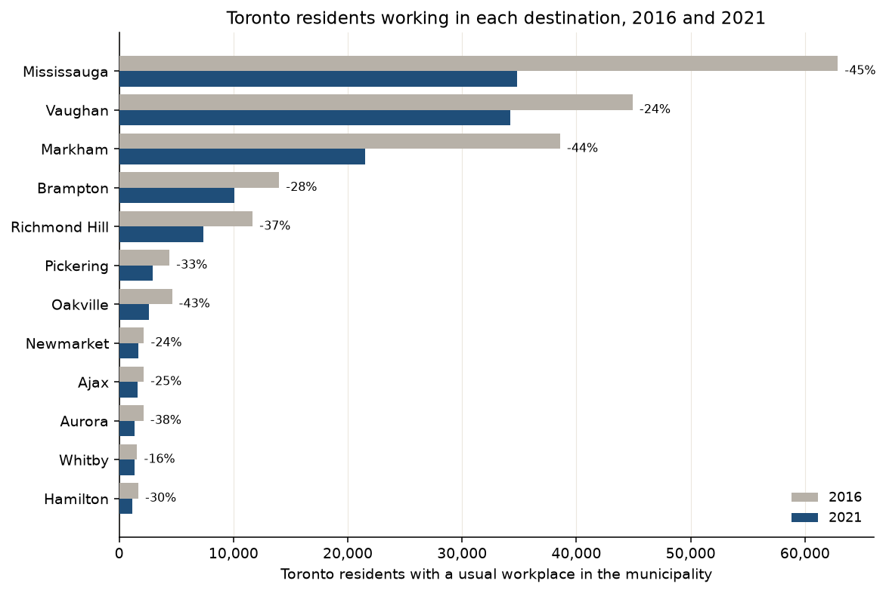
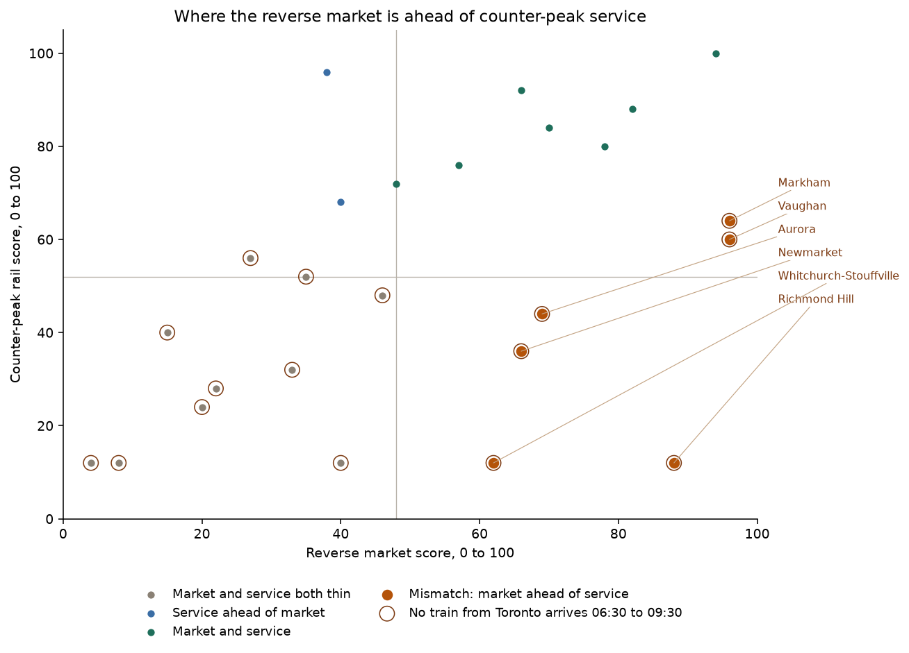
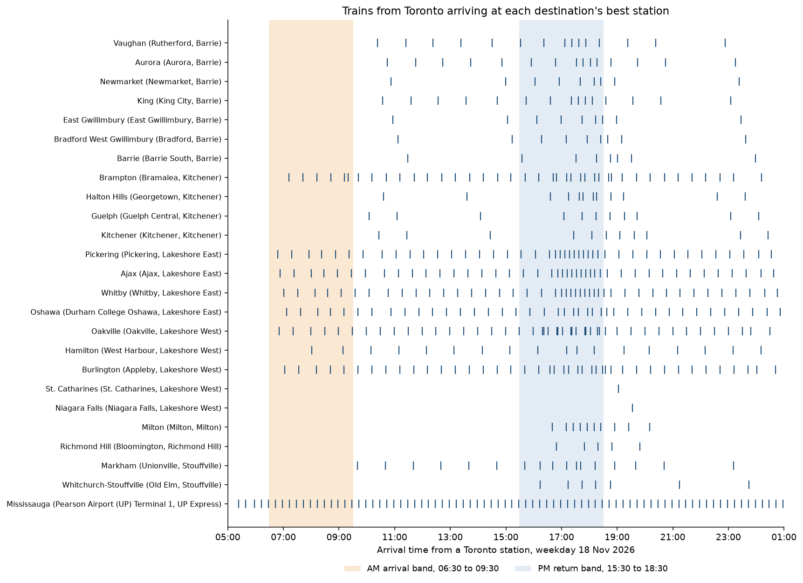

# Evaluating whether counter-peak rail service aligns with changing commuting patterns.

This project looks at Toronto residents whose usual workplace is in a suburb with a GO or UP station. I ask where that reverse market is large and where the counter-peak timetable does not get them to work in the morning and home in the evening. I then name the gap I would act on first.

This is an independent open-data project. It is not a Metrolinx publication, and it does not estimate boardings.

- Stakeholder note: [reports/executive_brief.md](reports/executive_brief.md)
- Methods: [reports/methods_note.md](reports/methods_note.md)
- Notebook walk-through: [notebooks/reverse_commute.ipynb](notebooks/reverse_commute.ipynb)
- Map of flows: [reports/flow_map.html](reports/flow_map.html)
- Design written before the build: [research_design.md](research_design.md)

## Research question

Where is the 2021 reverse-commute market from Toronto large relative to GO's counter-peak timetable, and is the larger gap the train or the trip from the station to the workplace?

I do not ask how many reverse commuters ride GO. Station boardings and PRESTO transactions are not on the open-data page, and the commuting-flow table has no mode. The result is a mismatch table, not a ridership forecast.

## Methodology

I did the work in this order. Settings and thresholds are in `src/reverse/config.py`, and the timetable queries are DuckDB SQL in `sql/`.

1. **Flows.** I first classified every 2021 commuting flow between census subdivisions (table 98-10-0459). A reverse commute is a Toronto home and a usual workplace in a subdivision with a GO or UP station. A Toronto home with a workplace somewhere without a station is kept apart, so it does not inflate the market. The 2021 file names the workplace without a code, so I matched names to the 2021 boundary file.
2. **2016 context.** I then classified the 2016 flows (98-400-X2016325) the same way and matched them to the 2021 subdivisions. I added work from home for Toronto and for each destination in both years. I read the change as context, not as an effect of hybrid work.
3. **Counter-peak supply.** I then took the GO and UP Express schedules for Wednesday 18 November 2026, Saturday 21 November, and Sunday 22 November. I built every one-seat ride that boards at any of the 20 Toronto stations and gets off at a destination station, and the reverse for the trip home. The Census places a home only at the subdivision level, which is why the boarding station is any Toronto station rather than Union. For each of the 51 destination stations I measured the median arrival headway from 06:30 to 09:30, the longest midday gap, the median return headway toward Toronto from 15:30 to 18:30, the weekday span from first arrival to last return, and the weekend span. A band with fewer than two trains gets the band length.
4. **Last mile.** I then drew 800 m and 2 km straight-line rings around each destination station and put the 2021 jobs by census tract of work (98-10-0498) into them by area. For each subdivision I measured the share of its jobs within 2 km of any of its stations. From 14 local GTFS feeds I counted the bus routes leaving each station in the AM band and the scheduled wait from a train to the next bus.
5. **Scores.** Only then did I score the 25 destination subdivisions. Every score is a percentile rank from 0 to 100, and higher is better.

| Score | What goes in |
| --- | --- |
| Market | Toronto residents working in the subdivision, and their share of its jobs |
| Rail | The best station's supply score: the mean of the ranks of arrival headway, return headway, longest midday gap, and span. A station with no train in a band shares the worst rank |
| Last mile | Share of jobs within 2 km of a station, and the most AM bus routes at any station in the subdivision |

**Analysis 1** splits the destinations at the median market score and the median rail score. A destination above the market median and below the rail median is a mismatch. A destination whose best station gets no train from Toronto between 06:30 and 09:30 is on the thin-service side at any rank. I added that rule after the first run, when Vaughan and Markham sat above the rail median with no morning train, because a relative rank cannot flag a gap most destinations share. I also mark destinations within 5 points of a median, and I recompute the set at the 40th and 60th percentiles of the rail score.

**Analysis 2** compares each mismatch with the destinations that have both a strong market and strong service. With no morning arrival, the timetable is the binding gap. Otherwise the larger deficit is the gap. Each mismatch gets a row in `reports/evidence.csv` with the supporting evidence, the evidence against, and a confidence of high, medium, or low.

## Data sources

Licences and links are in [data/SOURCES.md](data/SOURCES.md). Raw files are not in git.

| Input | What I use it for | Publisher |
| --- | --- | --- |
| GO and UP Express GTFS | Stations and the three service dates | Metrolinx Open Data |
| 14 local GTFS feeds | AM bus routes and train-to-bus waits at destination stations | Mobility Database, each agency's own feed |
| Table 98-10-0459 | 2021 flows between census subdivisions | Statistics Canada |
| 98-400-X2016325 | 2016 flows between census subdivisions | Statistics Canada |
| Table 98-10-0498 | 2021 jobs by census tract of work | Statistics Canada |
| 2021 Census Profile, dissemination area | 2021 work from home and usual place of work | Statistics Canada, via the Data for Canada Parquet copy |
| 98-401-X2016055 | 2016 work from home and usual place of work by subdivision | Statistics Canada |
| 2021 boundaries | Tracts and subdivisions | Statistics Canada |

The 2016 files are behind a browser security check, so I saved them through a browser. The download script prints the URL when it is blocked.

## Interpretation

The reverse market is smaller than in 2016, and it held its share. Toronto residents with a usual workplace in a station municipality fell from 199,225 in 2016 to 126,210 in 2021. Over the same period, work from home among employed Toronto residents went from 7.4% to 39.0%. As a share of Toronto residents with a usual place of work, the reverse commute went from 18.2% to 19.5%. Inbound commuting to Toronto from other Ontario municipalities fell faster, by 48%, against 37% for the reverse flow. In Vaughan the reverse flow fell 24% while the inbound flow fell 47%.

Six destinations are a mismatch: Vaughan, Markham, Richmond Hill, Aurora, Newmarket, and Whitchurch-Stouffville. Together they held 66,860 of the 126,210 reverse commuters in 2021. None of them gets a GO or UP train from Toronto arriving between 06:30 and 09:30. So the result does not depend on the median cut: they are a mismatch at the 40th, 50th, and 60th percentiles, and every destination with a morning train stays on the same side at all three cuts.

| Destination | Best station | First arrival from Toronto | How I read it |
| --- | --- | --- | --- |
| Vaughan | Rutherford | 10:23 | The largest market on the list after Mississauga, 34,235 workers. Barrie line trains reach it from mid-morning on. Only 10% of Vaughan's jobs are within 2 km of a station, so a train alone would not finish the trip. The TTC subway reaches Vaughan Metropolitan Centre and is outside this GO-only analysis |
| Markham | Unionville | 09:40 | 21,490 workers. The first train arrives 10 minutes after the band closes, so one earlier trip is the cheapest test. 26% of jobs are within 2 km |
| Richmond Hill | Bloomington | 16:49 | The line runs toward Union in the morning and away from it in the evening. No reverse trip exists in either band |
| Aurora, Newmarket | Aurora, Newmarket | 10:44, 10:52 | Barrie line, small markets of 1,320 and 1,650 workers. The station area holds 35% and 41% of jobs, so the last mile is not the larger gap |
| Whitchurch-Stouffville | Old Elm | 16:14 | Peak-direction only, like Richmond Hill. The last mile is also behind |

The reference group is Mississauga, Pickering, Brampton, Ajax, Oakville, Whitby, and Oshawa. Lakeshore and Kitchener stations there get a train from Toronto about every 30 minutes from before 07:15, and the scheduled train-to-bus wait is 4 to 9 minutes. Mississauga's best station is Pearson on the UP Express, every 15 minutes from 05:23, which describes the airport rather than the Lakeshore West or Milton stations. Oshawa and King are within 5 points of a median.

The recommendation for all six is the same owner and the same first step: Metrolinx service planning adds counter-peak trips from Toronto that arrive before 09:00, with a return after 17:00. The KPIs are the first arrival, the arrival headway, and the last departure back to Toronto. At Vaughan, Markham, and Whitchurch-Stouffville I would plan the bus connection with the municipal operator at the same time.

A thin timetable next to a large reverse count is a planning gap. It is not evidence that those workers would ride. The 2021 Census was taken during a lockdown, counts are randomly rounded, and the flow is from 2021 while the timetable is from 2026.







## Project structure

```text
Reverse_Commute/
├── README.md
├── research_design.md           # the design, written before the build, with the changes listed
├── requirements.txt
├── pytest.ini
├── notebooks/
│   └── reverse_commute.ipynb    # the analysis, in the order I did the work
├── scripts/
│   ├── download_data.py         # GTFS and census, with --seed to copy the scorecard's raw files
│   ├── run_analysis.py          # builds the tables, figures, map, and brief
│   └── build_notebooks.py       # rewrites the notebook from the narrative
├── sql/                         # DuckDB queries: rail events, reverse pairs, counter-peak supply, train-to-bus waits
├── src/reverse/
│   ├── config.py                # dates, bands, thresholds
│   ├── download.py
│   ├── census.py                # 2021 and 2016 flows, place-of-work status, jobs by tract
│   ├── flows.py                 # flow classes and the destination table
│   ├── gtfs.py                  # stations, pairs, counter-peak supply, feeders
│   ├── lastmile.py              # station rings and subdivision job coverage
│   ├── mismatch.py              # Analysis 1 and Analysis 2, evidence, recommendations
│   ├── viz.py
│   ├── brief.py
│   └── pipeline.py
├── tests/
│   └── test_reverse.py
├── reports/
│   ├── executive_brief.md
│   ├── methods_note.md
│   ├── data_dictionary.md
│   ├── evidence.csv
│   ├── flow_map.html
│   └── figures/
└── data/
    ├── SOURCES.md
    ├── processed/               # tables the notebook reads
    ├── raw/                     # not in git
    └── interim/                 # not in git
```

## Requirements

I developed and ran this on Python 3.14. Packages are listed in [requirements.txt](requirements.txt), without pins:

`pandas`, `numpy`, `geopandas`, `shapely`, `pyproj`, `duckdb`, `scipy`, `matplotlib`, `folium`, `pyarrow`, `requests`, `jupyter`, `nbformat`, `nbclient`, `pytest`.

The processed tables, figures, brief, and notebook outputs are in the repository, so you can read the results without the raw files. The repo is standalone. It copies the scorecard's loaders rather than importing them.

## Setup

```bash
python -m venv .venv
source .venv/bin/activate
pip install -r requirements.txt
```

To read the results that are already built:

```bash
jupyter notebook notebooks/reverse_commute.ipynb
```

To rebuild from source:

```bash
python scripts/download_data.py --seed ../go-station-scorecard/data/raw   # or without --seed
python scripts/run_analysis.py
python scripts/build_notebooks.py
jupyter nbconvert --to notebook --execute notebooks/reverse_commute.ipynb --inplace
pytest
```

If the 2016 files are blocked, the download script prints the URL and the file name to save under `data/raw/census`. `scripts/run_analysis.py` rewrites the tables, the figures, the map, and the executive brief. It does not rewrite this README.

## Possible extensions

- Rerun the flows on the 2026 Census when it is released. It is the first count after hybrid work settled, and the 2021 count was taken during a lockdown.
- Add the TTC subway and the cross-boundary bus routes, so Vaughan Metropolitan Centre and the York Region bus network are measured as part of the reverse trip.
- Replace the straight-line rings with a walking network, and the scheduled train-to-bus wait with observed waits.
- Split the reverse market by the Toronto home tract, if a tract-to-subdivision flow table becomes available, so each commuter is tied to a boarding station.
- Test the mismatch list against counter-peak boardings, if those become available. I would treat that as a check on the table, not a replacement for it.

## Author

Bhavleen Kaur

[LinkedIn](https://linkedin.com/in/bhavleen-kaur-bk) · [GitHub](https://github.com/bhavleenkaur-econ)
