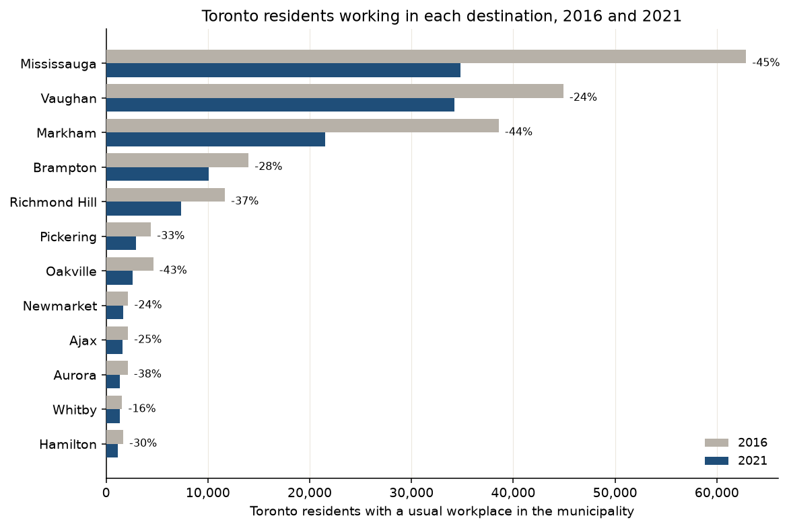
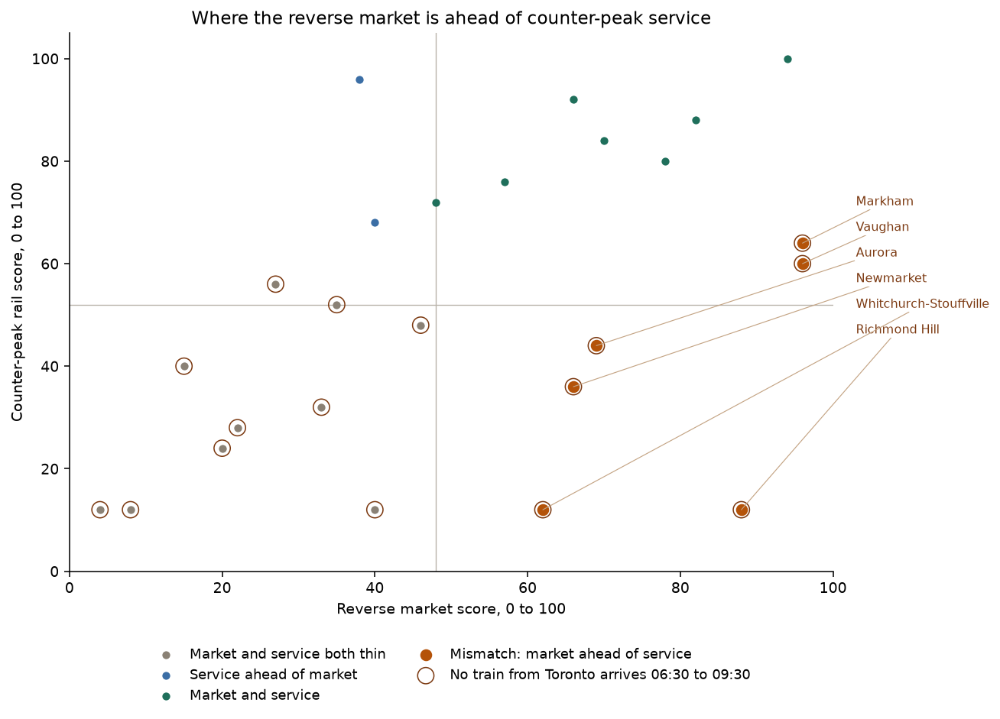
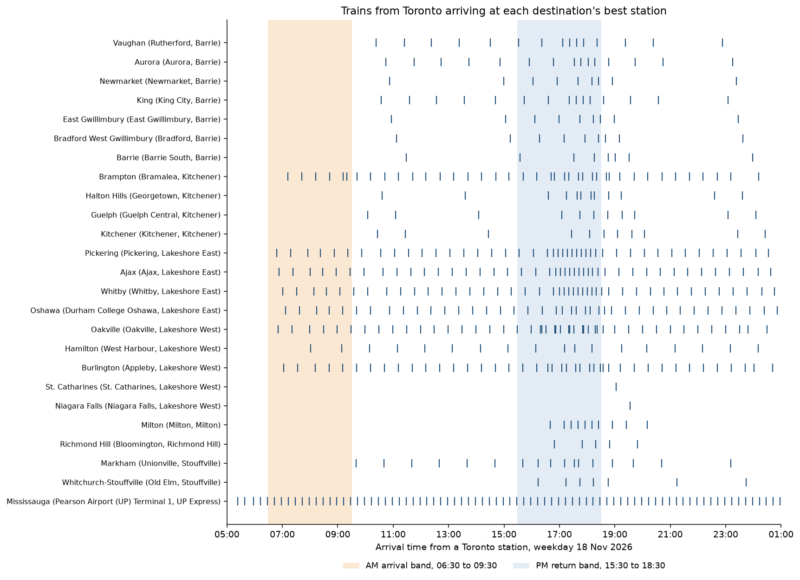
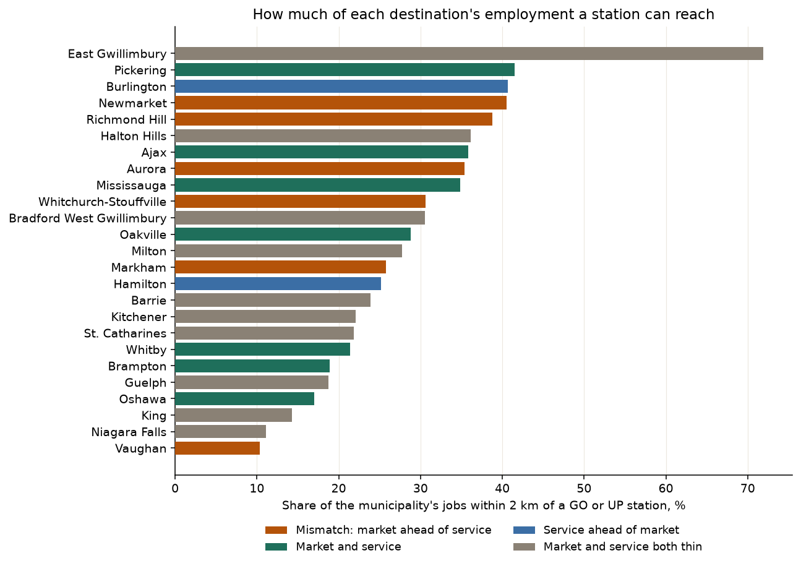

# Reverse commuting from Toronto, and whether GO serves it

## Objective

I asked where Toronto residents who work in the suburbs are numerous, and where the GO and UP timetable does not get them to work in the morning and home in the evening. I did not estimate ridership. Station boardings and PRESTO transactions are not open, so I measured the market from the Census commuting flows and the service from the published timetable.

## What I did, in order

I first took the 2021 Census commuting flows between census subdivisions and kept Toronto residents whose usual workplace is in a municipality with a GO or UP station. I then added the 2016 flows as context. I then took the GO and UP Express schedule for Wednesday 2026-11-18, the Saturday, and the Sunday, and found every one-seat ride that boards at a Toronto station and gets off at a station outside Toronto. The Census places a home only at the municipality level, so a reverse commuter can board at any of the 20 Toronto stations. For each of the 51 destination stations I measured the arrival headway from 06:30 to 09:30, the longest midday gap, the return headway toward Toronto from 15:30 to 18:30, and the span from the first arrival to the last return. I then measured the last mile: jobs within 800 m and 2 km of each station, the share of the municipality's jobs within 2 km, the local bus routes leaving the station in the morning band, and the scheduled wait from a train to the next bus. Only then did I score the 25 destination municipalities.

## Method

Every score is a percentile rank from 0 to 100, and higher is better. The market score is the mean of two ranks: the number of Toronto residents working in the municipality, and their share of its jobs. The rail score ranks the best station in each municipality on the mean of four station ranks: arrival headway, return headway, longest midday gap, and span. A station with no train in a band shares the worst rank for that band. The last-mile score is the mean of the 2 km job share and the morning bus routes.

Analysis 1 is a quadrant. The market median is 48.0 and the rail median is 52.0. A destination above the market median and below the rail median is a mismatch. A destination whose best station gets no train from Toronto between 06:30 and 09:30 counts as thin service at any rank, because a relative rank cannot flag a gap that most destinations share. Analysis 2 compares each mismatch with the 7 destinations that have both a strong market and strong service, and names the larger gap: the counter-peak timetable or the station-to-workplace link.

## Context: 2016 to 2021

I first set the 2021 picture against 2016. In 2016, 101,275 of 1,361,375 employed Toronto residents worked at home (7.4%). In 2021 the count was 510,065 of 1,308,185 (39.0%). Toronto residents with a usual place of work fell from 1,093,360 to 648,615.

Toronto residents with a usual workplace in a municipality that has a GO or UP station fell from 199,225 to 126,210 (-37%). Ontario residents of other municipalities with a usual workplace in Toronto fell from 454,465 to 237,165 (-48%). As a share of Toronto residents with a usual place of work, the reverse commute went from 18.2% to 19.5%. I read that as a smaller market that held its share, not as a reverse commute that grew. The 2021 count was taken during a lockdown.

The largest destinations, 2016 to 2021: Mississauga 62,875 to 34,845 (-45%, inbound -52%); Vaughan 44,920 to 34,235 (-24%, inbound -47%); Markham 38,575 to 21,490 (-44%, inbound -49%); Brampton 13,995 to 10,055 (-28%, inbound -39%); Richmond Hill 11,670 to 7,350 (-37%, inbound -55%); Pickering 4,395 to 2,925 (-33%, inbound -46%).

## What I found

I found 6 destinations where the reverse market is ahead of counter-peak service: Vaughan, Markham, Richmond Hill, Aurora, Newmarket, and Whitchurch-Stouffville. Together they had 66,860 Toronto residents with a usual workplace there in 2021, out of 126,210 across all 25 destinations. At every one of them, no GO or UP train from any Toronto station arrives between 06:30 and 09:30.

| Destination | Best station | Line | Toronto residents, 2021 | Market | Rail | Last mile | First arrival | Gap I would act on | Confidence |
| --- | --- | --- | ---: | ---: | ---: | ---: | --- | --- | --- |
| Vaughan | Rutherford | Barrie | 34,235 | 96 | 60 | 17 | 10:23 | Counter-peak timetable | high |
| Markham | Unionville | Stouffville | 21,490 | 96 | 64 | 51 | 09:40 | Counter-peak timetable | high |
| Richmond Hill | Bloomington | Richmond Hill | 7,350 | 88 | 12 | 74 | 16:49 | Counter-peak timetable | high |
| Aurora | Aurora | Barrie | 1,320 | 69 | 44 | 63 | 10:44 | Counter-peak timetable | high |
| Newmarket | Newmarket | Barrie | 1,650 | 66 | 36 | 71 | 10:52 | Counter-peak timetable | high |
| Whitchurch-Stouffville | Old Elm | Stouffville | 815 | 62 | 12 | 43 | 16:14 | Counter-peak timetable | high |

The first train from Toronto reaches Markham (Unionville, 09:40) within 30 minutes after the band closes. That destination is one earlier trip away from a usable morning arrival, so it is the cheapest test of the gap.

At Richmond Hill and Whitchurch-Stouffville, the first train from Toronto arrives after 15:30. Those lines run toward Union in the morning and away from it in the evening, so the reverse commute has no train in either direction when it needs one.

The 7 destinations with both a strong market and strong service are Mississauga, Pickering, Brampton, Ajax, Oakville, Whitby, and Oshawa. They form the reference group. Their median rail score is 84 and their median last-mile score is 65.

The median is one cut. I also split the rail score at the 40th percentile (42.4) and the 60th (61.6). Destinations with no morning arrival are a mismatch at every cut: Aurora, Markham, Newmarket, Richmond Hill, Vaughan, and Whitchurch-Stouffville. Among destinations that do have a morning arrival, the ones in the mismatch set at all three cuts are: none. Threshold-sensitive (a mismatch at the median, not at the 40th): none. Joining only at the 60th: none.

These destinations sit within 5 points of a median, so I do not treat their side of the cut as firm: Oshawa (market and service) and King (market and service both thin).

## Competing explanations

For each mismatch, I put the gap I would act on next to the evidence that supports it and the evidence that cuts against it. When no train arrives in the morning band, I treat the timetable as the binding gap, because nothing at the station end can be used without a train. Otherwise the larger deficit against the reference destinations is the gap. Confidence is low under a 10-point deficit, medium for a tie within 10 points or a destination near a cut, and high otherwise.

| Destination | Gap | Confidence | Supporting evidence | Contradictory evidence |
| --- | --- | --- | --- | --- |
| Vaughan | Counter-peak timetable | high | No train from Toronto reaches the municipality between 06:30 and 09:30: at Rutherford, the best station, the first train from Toronto arrives at 10:23, 0 trains arrive from 06:30 to 09:30, the longest midday gap is 67 minutes, and the last train back to Toronto leaves at 21:16. | The station-to-workplace link is also behind, by 48 points: 10% of the municipality's jobs sit within 2 km of a station, the station with the most local service has 3 bus routes leaving in the AM band. |
| Markham | Counter-peak timetable | high | No train from Toronto reaches the municipality between 06:30 and 09:30: at Unionville, the best station, the first train from Toronto arrives at 09:40, 0 trains arrive from 06:30 to 09:30, the longest midday gap is 60 minutes, and the last train back to Toronto leaves at 20:38. | The station-to-workplace link is also behind, by 14 points: 26% of the municipality's jobs sit within 2 km of a station, the station with the most local service has 6 bus routes leaving in the AM band. |
| Richmond Hill | Counter-peak timetable | high | No train from Toronto reaches the municipality between 06:30 and 09:30: at Bloomington, the best station, the first train from Toronto arrives at 16:49, 0 trains arrive from 06:30 to 09:30, the longest midday gap is 330 minutes, and the last train back to Toronto leaves at 07:54. | The station-to-workplace link sits 9 points above the reference destinations: 39% of the municipality's jobs sit within 2 km of a station, the station with the most local service has 7 bus routes leaving in the AM band. |
| Aurora | Counter-peak timetable | high | No train from Toronto reaches the municipality between 06:30 and 09:30: at Aurora, the best station, the first train from Toronto arrives at 10:44, 0 trains arrive from 06:30 to 09:30, the longest midday gap is 67 minutes, and the last train back to Toronto leaves at 20:55. | The station-to-workplace link is also behind, by 2 points: 35% of the municipality's jobs sit within 2 km of a station, the station with the most local service has 6 bus routes leaving in the AM band. |
| Newmarket | Counter-peak timetable | high | No train from Toronto reaches the municipality between 06:30 and 09:30: at Newmarket, the best station, the first train from Toronto arrives at 10:52, 0 trains arrive from 06:30 to 09:30, the longest midday gap is 247 minutes, and the last train back to Toronto leaves at 13:53. | The station-to-workplace link sits 6 points above the reference destinations: 41% of the municipality's jobs sit within 2 km of a station, the station with the most local service has 6 bus routes leaving in the AM band. |
| Whitchurch-Stouffville | Counter-peak timetable | high | No train from Toronto reaches the municipality between 06:30 and 09:30: at Old Elm, the best station, the first train from Toronto arrives at 16:14, 0 trains arrive from 06:30 to 09:30, the longest midday gap is 330 minutes, and the last train back to Toronto leaves at 09:07. | The station-to-workplace link is also behind, by 22 points: 31% of the municipality's jobs sit within 2 km of a station, the station with the most local service has 2 bus routes leaving in the AM band. |

## Recommendations

**Counter-peak timetable.** Vaughan, Markham, Richmond Hill, Aurora, Newmarket, and Whitchurch-Stouffville. Add counter-peak trains from Toronto that arrive before 09:00, and a return after 17:00, before adding peak trips toward Union. The owner is Metrolinx service planning. I would track the first arrival from Toronto, AM arrival headway, and last departure back to Toronto.

A train alone would not finish the trip at Vaughan (10% of jobs within 2 km), Whitchurch-Stouffville (31% of jobs within 2 km), and Markham (26% of jobs within 2 km). There the station-to-workplace link is also at least 10 points behind the reference destinations, so I would plan the bus connection with the municipal operator at the same time as the timetable change.

## Constraints

The 2021 Census was taken in May 2021, during a lockdown, and Statistics Canada rounds every count at random to a multiple of 5. I set a 2021 flow beside a 2026 timetable, so the market may have moved since. The flow table places homes only at the municipality level, so I cannot tell a resident near Union from one near Kipling. The last mile uses straight-line rings, not a walking network, and bus waits are scheduled, not observed. The best-station rule picks Pearson for Mississauga, which describes the airport, not the Lakeshore West or Milton stations. The TTC subway reaches Vaughan Metropolitan Centre and is outside this GO-only analysis, so the Vaughan gap is a GO gap, not a transit gap. Stratford has no census subdivision in the study box and is left out.

## What I would measure next

If a morning trip from Toronto is added on a mismatch line, I would track the first arrival, the arrival headway, and, once boardings exist, counter-peak boardings at the destination station against a station on a line that did not change. I would also rerun the flows on the 2026 Census when it is released, because that is the first count after hybrid work settled.

